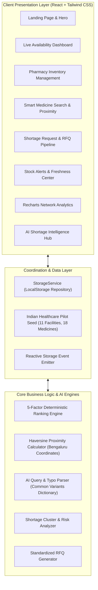

# MedStock AI — Smart Essential Medicine Availability & Shortage Coordination Platform

> **"Find Medicines Faster. Connect Healthcare Better."**  
> *A production-ready MVP designed for healthcare shortage coordination across urban clinics, hospitals, and community pharmacies.*

[](https://www.typescriptlang.org/)
[](https://reactjs.org/)
[](https://tailwindcss.com/)
[](https://vitejs.dev/)
[]()

---

## 1. Problem Statement

Hospitals, outpatient clinics, and nursing homes frequently encounter abrupt stockouts of life-saving essential medicines (e.g., broad-spectrum injectable antibiotics, regular insulin, anti-asthmatic respules). Currently, inventory information across community chemists and hospital distribution networks is fragmented.

When an emergency shortage strikes, healthcare staff and attending physicians waste precious minutes manually calling multiple local pharmacies one-by-one to check availability. This leads to:
- Critical delays in emergency and intensive care treatment
- Unverified, stale stock assurances that result in failed ambulance pick-ups
- High administrative burden on clinical staff during crisis shifts

**MedStock AI** solves this by establishing a decentralized, verified medicine availability mesh. Participating pharmacies maintain live stock counts and freshness verification timestamps, while clinics can intelligently discover nearby stock, rank candidate suppliers via multi-factor matching, and dispatch standardized procurement RFQs with a single click.

---

## 2. System Architecture



---

## 3. Key Implemented Features

### A. Demo Role Switcher
- Instant toggle between **Clinic / Hospital Requester** (*Dr. Priya Sundaram @ Apollo Urban Clinic*) and **Dispensing Pharmacy Supplier** (*Ramesh Patel @ MedPlus Express*).
- Allows hackathon judges to experience the full coordination lifecycle from both viewpoints without complex authentication hurdles.

### B. Dynamic Clinical Dashboard
- Live calculated KPI cards:
  - Total participating suppliers (8 verified pharmacies)
  - Catalog medicines listed (18 WHO / NLEM 2022 drugs)
  - Active shortage requests with emergency criticality tags
  - Depleted / Low-stock SKU count
- Live activity feeds for recent stock updates and pending clinic requests.

### C. Medicine Inventory Management (Pharmacy Role)
- Searchable, filterable table displaying formulation, active ingredients, batch numbers, unit prices in INR (₹), and verification timestamps.
- **Inline quick stock adjustments** (+10, -5, manual).
- **One-click Re-verify Stock** button that bumps the timestamp to ensure reports remain verified.
- **Mark as Out-of-Stock** quick trigger.
- **Add & Edit Medicine Modals** with client-side quantity and threshold validation.

### D. Smart Medicine Search & Proximity Discovery (Clinic Role)
- Natural language query parser with typo tolerance (e.g., handles *"paracetmol"*, *"ceftraxone"*, *"amoxclav"*).
- Multi-dimensional filters: Dosage form, Bengaluru district, stock availability, distance radius (2 km – 35 km), and verified freshness.
- Live road distance calculation in kilometers relative to the active facility using the Haversine formula.
- **Contact Supplier modal** with direct phone numbers, email, and contact persons.
- Clear empty state with helpful guidance and zero automatic medicine substitutions.

### E. 5-Factor Deterministic Supplier Matching Engine
When a clinic requests stock, candidates are strictly ranked by:
1. **Exact Medicine & Formulation Match** (+30 pts)
2. **Sufficient Reported Quantity** (+25 pts)
3. **Proximity in km** (+25 pts for &le; 3 km; +15 pts for &le; 8 km)
4. **Report Freshness** (+15 pts for &lt; 3h; -20 pts penalty for stale reports)
5. **Mandatory Supplier Confirmation Notice** (Safety protocol)
*Every ranking result explicitly displays human-readable reason codes explaining why the pharmacy was selected.*

### F. Shortage Request & RFQ Pipeline
- Status workflow: `Open (Pending Match)` &rarr; `Supplier Contacted` &rarr; `Availability Confirmed` &rarr; `Fulfilled` &rarr; `Cancelled`.
- Clinics can broadcast open requests or assign them directly to candidate pharmacies.
- Pharmacies receive incoming requests and can **Confirm Stock Availability** or **Mark Fulfilled**.
- **1-Click AI RFQ Generator**: Compiles a standardized clinical request ready for WhatsApp, SMS, or Email.

### G. Configurable Freshness Alerts & Stale Inventory Warnings
- Alerts trigger automatically on threshold breach, stockout, unresponded urgent requests, or stale reports.
- **Configurable Freshness Threshold slider**: 12h, 24h, 48h, or 72h.
- Stale inventory reports are visibly badged as `Unverified` to prevent clinics from dispatching couriers on outdated data.

### H. Network Shortage Analytics
- **Recharts** interactive data visualizations:
  - Most frequently requested medicines bar chart
  - Request pipeline status donut chart
  - Stockout vs. healthy stock distribution by therapeutic drug category
  - Supplier response rate percentage
  - Average fulfillment turnaround time calculation

---

## 4. AI vs. Deterministic Logic: Safety Architecture

Healthcare applications require clinical precision. MedStock AI maintains strict separation between deterministic safety logic and assistive AI capabilities:

| Functional Area | Methodology Used | Justification |
| :--- | :--- | :--- |
| **Medicine Formulations & Strengths** | **100% Deterministic** | Prevents dangerous LLM hallucinations. Strengths (e.g. 1g vs 500mg) must match catalog specifications exactly. |
| **Alternative Drug Substitutions** | **Prohibited by Design** | MedStock AI coordinates availability; it never recommends therapeutic drug substitutions without physician oversight. |
| **Supplier Ranking & Proximity** | **Deterministic Scoring** | Transparent, predictable scoring based on Haversine distance, quantity counts, and timestamp deltas. |
| **Search Query & Typo Interpretation** | **AI / Fuzzy NLP** | Tolerates real-world doctor/nurse shorthand and misspellings (*"ceftraxone"* &rarr; Ceftriaxone 1g). |
| **Shortage Risk & Pattern Synthesis** | **AI Intelligence** | Scans request logs to detect regional cluster deficits (e.g. ICU antibiotic spikes). |
| **Supplier RFQ Summarization** | **AI Structured Formatting** | Translates clinical urgency and specs into a professional, unambiguous RFQ message. |

---

## 5. Seed Dataset (Bengaluru Pilot Mesh)

The application comes pre-populated with realistic Indian healthcare data:
- **3 Hospitals & Clinics**:
  - *Apollo Urban Clinic* (Indiranagar)
  - *City Health Community Hospital* (Koramangala)
  - *St. Martha Family Health Center* (Malleshwaram)
- **8 Community Pharmacies & Institutional Distributors**:
  - *MedPlus Express* (Indiranagar)
  - *Apollo 24/7 Chemist* (Koramangala)
  - *TrustCare Institutional Medicals* (HSR Layout)
  - *Sanjivani Lifeline Chemists* (BTM Layout)
  - *CarePoint Essential Drugs* (Whitefield)
  - *Dhanvantari MediStore* (Jayanagar 4th Block)
  - *National Pharma Distributors* (Electronic City Phase 1)
  - *Metro Care Chemists* (Malleshwaram West)
- **18 WHO / NLEM Essential Medicines**:
  - Ceftriaxone 1g IV/IM, Meropenem 1g, Piperacillin-Tazobactam 4.5g, Amoxicillin-Clavulanate 625mg, Azithromycin 500mg, Paracetamol 650mg, Human Regular Insulin 100 IU/ml, Salbutamol Inhaler, Enoxaparin 40mg, etc.
- **7 Pre-configured Shortage Requests** across varied stages of completion.

*A dedicated **"Reset Demo"** button in the navigation header allows presenters to restore the dataset back to baseline anytime.*

---

## 6. Quick Start & Setup Instructions

### Prerequisites
- Node.js (v18.0.0 or higher)
- npm (v9.0.0 or higher)

### Installation & Run

1. **Clone or Navigate to the Project Root**:
   ```bash
   cd c:\Users\asus\OneDrive\Desktop\Firstproject
   ```

2. **Navigate to the Frontend Directory and Start the Dev Server**:
   ```bash
   cd frontend
   npm run dev
   ```
   *(Or on Windows PowerShell where script policies are restricted, use `npm.cmd run dev`)*

3. **Open the Application**:
   Open your browser and navigate to:
   ```
   http://127.0.0.1:3000/
   ```

4. **Production Build (Optional)**:
   ```bash
   cd frontend
   npm run build
   npm run preview
   ```

---

## 7. Hackathon Judge Demonstration Script

Follow this 3-minute journey to demonstrate the core value of MedStock AI:

1. **Step 1: Product Overview (Landing Page)**
   - Start at the **Home & Overview** tab.
   - Point out the real-time Bengaluru network stats (8 Pharmacies, 3 Clinics, 18 Essential Medicines).
   - Click **"Open Live Dashboard"**.

2. **Step 2: The Shortage Crisis (Clinic Role)**
   - Note the top persona: currently logged in as **Dr. Priya Sundaram** (*Apollo Urban Clinic - Indiranagar*).
   - Observe the KPI cards: notice the **Critical Alert** for Ceftriaxone 1g injection stockout in emergency care.
   - Navigate to **"Smart Medicine Search"**.

3. **Step 3: AI Search & Proximity Discovery**
   - Click the quick test chip: `urgent 30 vials ceftraxone 1g near Indiranagar`.
   - Show how the AI query parser correctly extracts medicine formulation, strength, quantity, and location despite typos.
   - Look at the candidate suppliers ranked by proximity: *Apollo 24/7 Koramangala* (4.8 km) and *TrustCare HSR* (6.7 km).
   - Click **"Request Stock"** on Apollo 24/7 Chemist and submit an urgent request.

4. **Step 4: Automated Matching & 1-Click RFQ**
   - Navigate to **"Shortage Requests"**.
   - Open your newly created request and click **"Match Nearby Suppliers"** to showcase the 5-factor scoring engine and transparent reason codes.
   - Click **"1-Click AI Supplier RFQ"** and demonstrate the standardized message generated for WhatsApp/SMS.

5. **Step 5: Fulfilling the Shortage (Switch to Pharmacy Role)**
   - Click the **Role Switcher** in the top navigation bar and select **Anand Kulkarni** (*Apollo 24/7 Chemist - Koramangala*).
   - Notice the incoming shortage alert under *Shortage Requests*.
   - Click **"Confirm Stock"**. The request status immediately updates to `Availability Confirmed`.
   - Click **"Mark Fulfilled"** to complete the dispatch workflow.

6. **Step 6: Real-time Analytics & Reset**
   - Navigate to **"Network Analytics"** to show how the charts (demand frequency, pipeline status, and response rates) dynamically reflect the newly fulfilled request.
   - Click **"Reset Demo"** in the top navigation bar to showcase instantaneous state restoration back to the hackathon baseline.

---

## 8. Limitations & Production Roadmap

### Known MVP Limitations
- **Simulated Distance**: Coordinates use real latitude/longitude within Bengaluru, but distance is calculated via straight-line Haversine rather than live Google Maps traffic routes.
- **Client Storage**: Uses browser `localStorage` for zero-configuration hackathon evaluation.

### Production Roadmap
1. **ABDM & E-Prescription Integration**: Connect with the Ayushman Bharat Digital Mission (ABDM) and National Digital Health Blueprint for verified clinic identification.
2. **ERP & Pharmacy POS Connectors**: Direct webhooks into Marg ERP, Retailio, and SAP Pharmacy inventory databases for automated live stock sync.
3. **Cold-Chain IoT Telemetry**: Real-time temperature sensors for insulin and biologics in transit.
4. **Geo-Fenced Priority Courier Integration**: Auto-dispatch Dunzo/Shadowfax/Porter medical priority couriers upon supplier stock confirmation.

---

## 9. License

Developed for the HealthTech Hackathon 2026. Distributed under the MIT License.
